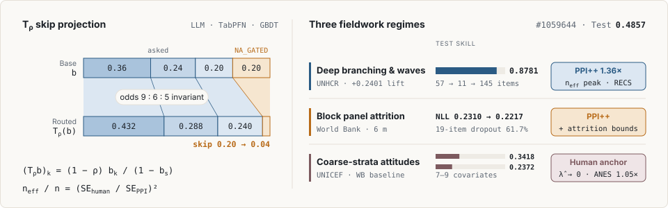

# Calibrated Skip-Logic Routing & Fieldwork Sample-Multiplier Toolkit

Simulator-agnostic skip-logic KL projection ($T_\rho$), cross-fitted Prediction-Powered Inference (`PPI++`) fieldwork planning (`toolkit/survey_routing.py`), and the complete **0.4857** Test-phase system (`#1059644`) for [SimulacraBench](https://simulacrabench.org/) (NeurIPS 2026 Competition Track).

<picture>
  <source media="(prefers-color-scheme: dark)" srcset="assets/overview-dark.svg">
  
</picture>

## Multi-Module Surveys Are Branching Graphs, Not Flat Tables

Household and longitudinal surveys (XLSForm / KoBoToolbox `relevant` filters, MICS modules, post-intervention panel waves) route respondents through conditional sub-questionnaires. Standard predictors, whether LLM persona simulators, tabular foundation models, or gradient-boosted trees, output substantive answer probabilities jointly with `NA_GATED` skip codes. Whenever skip or attrition probability drifts, joint normalization distorts substantive answer odds.

Decoupling *whether an item is asked* ($\rho$) from *how asked respondents answer* yields an exact closed-form rescaling $T_\rho$ onto $`\{q \in \Delta^{K-1} : q_s = \rho\}`$:

```math
(T_\rho b)_s = \rho, \qquad (T_\rho b)_k = (1 - \rho)\frac{b_k}{1 - b_s} \quad (k < s), \qquad H(p^{\ast}, b) - H(p^{\ast}, T_\rho b) = D_{\mathrm{KL}}^{\mathrm{Bern}}(\pi^{\ast} \| b_s) - D_{\mathrm{KL}}^{\mathrm{Bern}}(\pi^{\ast} \| \rho).
```

$T_\rho$ uniquely minimizes both forward and reverse KL divergence onto the skip-constrained simplex. Cross-entropy drops whenever binary skip KL risk decreases, while asked-conditional substantive answer odds remain strictly invariant.

## Zero-Dependency Drop-In Toolkit (`toolkit/survey_routing.py`)

`toolkit/survey_routing.py` (`numpy` only) wraps probability tables from **any** LLM respondent simulator or tabular model without installing the full competition stack:

1. `project_skip_probability(probs, rho, skip_idx=-1, floor=0.0)` recalibrates filter-skip or wave-attrition mass via $T_\rho$ without perturbing substantive answer ratios.
2. `ppi_categorical_ci(y_labeled, probs_labeled_oof, probs_unlabeled)` pairs cross-fitted predictions on primary human interviews with predictions on augmented respondents to deliver unbiased category shares, asymptotic confidence intervals, and the **effective fieldwork sample multiplier** $`n_{\mathrm{eff}} / n = (\mathrm{SE}_{\mathrm{human}} / \mathrm{SE}_{\mathrm{PPI}})^2 \ge 1`$ ([Angelopoulos et al., *Science* 2023](https://doi.org/10.1126/science.adi6000); [PPI++, arXiv:2311.01453](https://arxiv.org/abs/2311.01453)).
3. `interview_budget_plan(target_effective_n, n_eff_multiplier, cost_per_interview)` translates empirical sample multipliers directly into primary interview counts and fieldwork budget savings.

```python
import numpy as np
from toolkit.survey_routing import project_skip_probability, ppi_categorical_ci, interview_budget_plan

# XLSForm relevant-filtered module: [Return <6m, Return 6-12m, Undecided, NA_GATED]
base = np.array([[0.36, 0.24, 0.20, 0.20], [0.10, 0.15, 0.25, 0.50], [0.05, 0.05, 0.10, 0.80]])
routed = project_skip_probability(base, rho=np.array([0.04, 0.62, 0.96]), skip_idx=-1)
# Row 0 -> [0.432, 0.288, 0.240, 0.040]: exact 9 : 6 : 5 asked-answer odds preserved (pass floor=1e-3 for log scoring)

# Fieldwork planning at 1.36x effective sample multiplier (measured on filter-structured RECS 2020):
plan = interview_budget_plan(target_effective_n=1000, n_eff_multiplier=1.36, cost_per_interview=45.0)
# -> 736 primary interviews match the precision of 1,000 unaugmented interviews (26.4% fieldwork budget saved)
```

## Where Synthetic Completion Multiplies Fieldwork Sample Size

Across UNHCR, World Bank, and UNICEF, the three SimulacraBench instruments trace a clear structural boundary for survey design and budget allocation:

| Instrument & Questionnaire Topology | Benchmark Readout | Structural Mechanism | Fieldwork Design Implication |
| :--- | ---: | :--- | :--- |
| **UNHCR ERPIS** (`10,349` households, `17` $\to$ `213` items) | **0.8781** *(Test skill)* | Multi-stage branching (`57 -> 11 -> 145` items; `64.4%` of loss on filtered items) + repeated waves | Strong sample-size amplification once questionnaire order (`+0.2401` Development skill) and opposite-wave household matching (`+0.0159` nats/item) are modeled. |
| **World Bank Follow-Up** (`SkillCraft` 6-month panel, `19` direct + `2` routed items) | **0.2310 $\to$ 0.2217** *(holdout NLL)* | Block wave attrition (`61.7%`, `758 / 1,229` experimental participants miss all 19 tracer items together) | Factoring shared wave dropout from retention-conditional pre-post transitions (`+0.0093` nats/item) powers follow-up `PPI++` and covariate-tightened attrition bounds. |
| **UNICEF & WB Baselines** (`19,846` rows, `7` $\to$ `12`; `6,927` rows, `9` $\to$ `76`) | **0.3418 / 0.2372** *(Test skill)* | Substantial within-cell human diversity across 7-to-9 baseline demographics | Numerical ceiling reflects genuine respondent diversity within demographic strata. `ppi_categorical_ci` ($\hat\lambda_k \to 0$) anchors unbiased inference on primary interviews with zero interval inflation. |

Validated across `62` public human survey items (`RECS 2020`, `NHANES 2011`, `ANES 2020`; $n = 300$ cross-fitted primary interviews plus unlabeled respondents), `ppi_categorical_ci` reaches **1.36x effective sample size** (`26.4%` fewer interviews at matched CI width; `0.943x` mean CI width) on filter-heavy `RECS 2020` and `1.05x` mean (`0.977x` CI width) on coarse-demographic `ANES 2020` attitudes, with worst-item multiplier **1.00x**.

## SimulacraBench Leaderboard & Reproducibility (`#1059644`)

| Phase | Overall (`skill`) | UNHCR (`skill_unhcr`) | UNICEF (`skill_unicef`) | World Bank (`skill_world_bank`) |
| :--- | ---: | ---: | ---: | ---: |
| **Test (`#1059644`)** | **0.4857** | **0.8781** | **0.3418** | **0.2372** |
| Development (`#1035477`) | 0.4814 | 0.8457 | 0.3499 | 0.2486 |
| Sample-marginal baseline ($R_d$) | 0.0000 | 0.0000 | 0.0000 | 0.0000 |

Continuous Test score (`#1059644`): `0.4856790266` (`0.8780828303` / `0.3417955115` / `0.2371587379`).

Build the exact 196-file `#1059644` archive and run `predict(frame, schema)`:

```bash
git ls-files -z ':!:LICENSE' ':!:assets' ':!:toolkit' | xargs -0 zip ../submission.zip
```

```python
import json, pandas as pd
from main import predict

schema = json.load(open("schema.json", encoding="utf-8"))
predictions = predict(pd.read_parquet("survey_frame.parquet"), schema)
```

| Full-Budget H100 Replay (`301` Targets, `3199.3s` net, `12.22 GiB` peak PSS) | UNHCR (`213`) | World Bank (`76`) | UNICEF (`12`) | Macro NLL (`nats/item`) | 5-Fold Foundations |
| :--- | ---: | ---: | ---: | ---: | ---: |
| Sample-marginal reference ($R_d$) | `0.654293` | `1.342990` | `1.153391` | `1.050225` | `0 / 301` |
| CPU gradient trees + survey priors | `0.563557` | `1.258410` | `0.836912` | `0.886293` | `0 / 301` |
| + 5-fold `TabPFN 3.5` & `Kumo-Tabular` | `0.559691` | `1.253968` | `0.833820` | `0.882493` | `301 / 301` |
| **+ Leave-one-out calibration & $T_\rho$ skip routing** | **`0.559625`** | **`1.253873`** | **`0.833736`** | **`0.882411`** | **`301 / 301`** |

<details>
<summary><strong>System architecture, 6-survey calibration audit, and pinned weights</strong></summary>

<br>

Across all `363` offline evaluation items (`301` partner-schema targets plus `62` public human items from `ANES 2020`, `NHANES 2011`, and `RECS 2020`), leave-one-respondent-out log-linear and $T_\rho$ calibration improves `87` items, worsens `0`, and leaves `276` unchanged (`-0.076180` summed OOF nats, `-0.055805` holdout nats; `70 / 0 / 293` on the stacked stream). CPU-only execution on `2 CPUs / 4 GiB RAM` finishes in `101` to `135s`.

- `main.py`, `final_config.py`: `predict(frame, schema)` entry point on `linux/amd64` Python 3.12/3.13 (`requirements.txt`), scheduling `1984s / 896s / 320s` net Test seconds across UNHCR, World Bank, and UNICEF.
- `gpu.py`, `models.txt`: 5-fold cross-fitting plus 50/50 full-sample refits for `Prior-Labs/tabpfn_3_5` (`06bf2ba35c80a92a3b9abb436b99cf49e7a0365e`: default and native 160-class `tabpfn-v3.5-20260909_multiclass.safetensors`) and `nvidia/Kumo-Tabular` (`c5893d418e162b9f841ae179dc767afefff73831`: `large/classifier.pt` via `bfloat16` memory mapping).
- `chain_features.py`, `propagate_structural_gates.py`, `post_orthogonal.py`, `irt_gh81.py`: questionnaire-order feature cascades, target-statistics CatBoost, LightGBM, warm-start HistGradientBoosting, floored Newton-L-BFGS simplex stacking, 81-node Gauss-Hermite IRT, and foldwise $T_\rho$ routing.
- `engine_v64/`, `engine_v56wb/`, `engine_v69/`: survey-specific modules for UNHCR (Sinkhorn wave matching), World Bank (joint panel attrition and pre-post transitions), and UNICEF (7-attribute Dirichlet shrinkage).
- Contract verification: `python3 toolkit/survey_routing.py` runs the standalone toolkit self-test; `check_submission_zip.py` from `SituatedEvals/public` validates `../submission.zip`.

</details>
